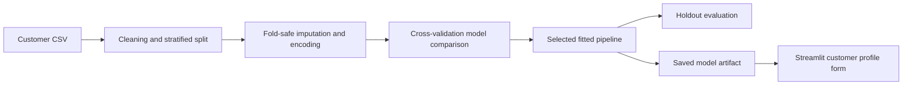

# Customer Churn Prediction Using Machine Learning

## Abstract

Customer churn is the loss of a customer who discontinues a service. This project develops a supervised binary classification workflow for predicting churn from telecom account, service, and billing attributes. It uses the supplied Telco customer dataset, compares Logistic Regression, Decision Tree, and Random Forest classifiers, and selects a model using stratified five-fold cross-validation. Preprocessing is included in each scikit-learn pipeline to prevent validation data from influencing imputation, scaling, or category encoding. On a stratified 20% holdout set, Logistic Regression achieved ROC-AUC 0.842, recall 0.783, and F1 0.614 at a 0.50 decision threshold. A saved pipeline and Streamlit interface demonstrate scoring a new customer profile. The findings apply to this historical dataset split and do not establish that retention actions based on predictions will reduce churn.

## 1. Introduction

Telecommunications providers offer recurring services and face the risk that customers may cancel or switch providers. Identifying customer profiles associated with churn can help frame retention analysis and direct further investigation. Machine learning can learn associations between historical customer attributes and a churn label, but its predictions require evaluation and should not be interpreted as causes.

## 2. Problem statement

Given a customer's recorded account, service, and billing details, classify whether the customer belongs to the `Churn = Yes` or `Churn = No` group. The dataset is imbalanced, so model assessment must include minority-class recall and precision alongside accuracy.

## 3. Objectives

1. Inspect and prepare the customer churn dataset.
2. Compare three supervised classification algorithms using stratified cross-validation.
3. Evaluate the selected model on a separate holdout sample.
4. Save the full preprocessing-and-classification pipeline for repeatable predictions.
5. Demonstrate predictions through a simple interactive interface.

## 4. Dataset and preparation

The supplied CSV contains 7,043 rows, 19 candidate features, and the `Churn` target. `customerID` is excluded because it is an identifier. Blank `TotalCharges` values are converted to zero; in this file they occur for customers with zero tenure. The target is mapped to 0 for No Churn and 1 for Churn. The original target counts are 5,174 No and 1,869 Yes.

The project retains a stratified 80/20 train/test split. Numerical fields are median-imputed and standardized. Categorical fields are imputed with their most frequent value and one-hot encoded with unseen categories ignored. These transformations are fitted inside each pipeline, separately within each cross-validation training fold. Class weights are used to account for class imbalance; SMOTE is not applied before validation.

## 5. Methodology

The candidate algorithms are:

- **Logistic Regression:** a linear baseline with class weighting.
- **Decision Tree:** a nonlinear, rule-based classifier with a minimum leaf size.
- **Random Forest:** an ensemble of decision trees with balanced subsampling.

The training portion is evaluated with five-fold stratified cross-validation. Mean ROC-AUC is the model selection criterion. The selected pipeline is fitted to the complete training split and evaluated once on the holdout split. The reported test threshold is 0.50. Metrics include accuracy, precision, recall, F1, ROC-AUC, PR-AUC, and the confusion matrix.

## 6. Results

### Cross-validation on the training split

| Model | Accuracy | Precision | Recall | F1 | ROC-AUC |
|---|---:|---:|---:|---:|---:|
| Logistic Regression | 0.748 | 0.517 | 0.801 | 0.628 | **0.846** |
| Random Forest | **0.788** | **0.592** | 0.644 | 0.617 | 0.837 |
| Decision Tree | 0.723 | 0.485 | 0.714 | 0.578 | 0.788 |

Logistic Regression was selected because it achieved the highest mean ROC-AUC across the five folds. Random Forest had higher mean accuracy and precision, while Logistic Regression found more churn cases on average. The preferred model therefore depends on the relative costs of missing a churner and contacting a customer who would stay.

### Holdout test set

| Metric | Result |
|---|---:|
| Accuracy | 0.738 |
| Precision | 0.504 |
| Recall | 0.783 |
| F1 | 0.614 |
| ROC-AUC | 0.842 |
| PR-AUC | 0.633 |

At the 0.50 threshold, the confusion matrix is `[[747, 288], [81, 293]]` with rows and columns ordered as No Churn, Churn. The model identified 293 of 374 churners in the holdout set and incorrectly flagged 288 non-churners. This shows why the threshold and outreach capacity need to be considered along with the ranking metric.

The generated plots are `cv_model_comparison.png`, `holdout_confusion_matrix.png`, and `feature_importance.png` in this folder. Feature importance describes model associations and is not a causal explanation.

## 7. System design



The model artifact contains the fitted preprocessing steps, classifier, feature names, threshold, and class labels. The prediction helper accepts raw category values and applies the same saved transformations as training.

## 8. Limitations and ethics

- The evaluation uses one historical dataset and one random holdout split; it is not external or time-based validation.
- Model scores are not calibrated probabilities.
- No retention-action outcomes or costs are provided, so the project cannot estimate business value or an optimal decision threshold.
- The available demographic fields may raise fairness concerns. Before real use, assess group-level error rates, privacy requirements, data freshness, and human review.
- Dataset provenance was not specified in the provided notebook. Add the dataset's required citation from the source or course instructions before academic submission.

## 9. Conclusion and future work

This project builds a reproducible churn classification pipeline and demonstrates how to use it for a single customer profile. Under the stated cross-validation criterion, Logistic Regression was the strongest candidate; its holdout recall was 0.783 and holdout ROC-AUC was 0.842. Future work should test on more recent or time-separated data, calibrate scores, select a threshold using explicit outreach costs, assess fairness, and monitor performance before any deployment.

## Reproduction

From the project root, install `requirements.txt`, then run:

```bash
python src/train_model.py --data data/telco_customer_churn.csv --output .
```

The script regenerates the model artifact, metrics JSON, and plots. Add your institution's required cover page, author details, supervisor details, and citation style before submitting this draft as a report.
